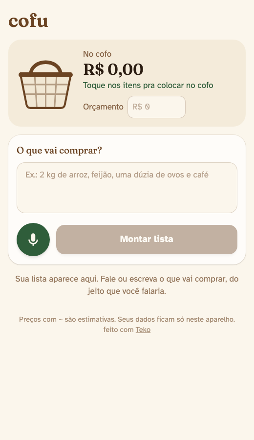
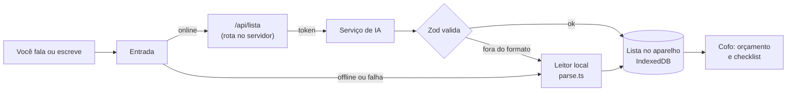

<p align="center">
  
</p>

<h1 align="center">Cofu</h1>

<p align="center">
  <b>Sua feira no cofo.</b> Fale ou escreva o que vai comprar e o Cofu monta a lista.<br />
  PWA offline, mobile first e voz primeiro.
</p>

<p align="center">
  <a href="https://github.com/tekiidev/cofu/actions/workflows/ci.yml"></a>
  <a href="LICENSE"></a>
  
  
  
  
</p>

<p align="center"></p>

O nome vem do **cofo**, o cesto de palha trançada do Maranhão usado pra carregar a feira. Feito em São Luís por **Felipe Oliveira** ([@tekiidev](https://github.com/tekiidev)), com a ajuda do [Teko](https://github.com/tekiidev/teko).

## Destaques

- 🎙️ **Voz primeiro**: "2 kg de arroz, uma dúzia de ovos e café" vira lista com item, quantidade, unidade, categoria e preço estimado
- 📴 **Funciona offline**: PWA com service worker; lista, checklist e cofo ficam no aparelho (IndexedDB com Dexie)
- 🧠 **IA com rede de segurança**: sem internet, sem serviço configurado ou se a IA falhar, um leitor local monta a lista mesmo assim
- ✅ **Saída da IA validada**: toda resposta passa por um schema Zod antes de entrar na lista; categoria desconhecida vira "Outros" e item inválido é recusado
- 🔐 **Chave fora do app**: a IA roda num serviço separado, chamado com token; o app nunca vê a chave do modelo
- ♿ **Acessível**: alvos de toque de 44 px, fonte mínima de 16 px, contraste alto e fonte Atkinson Hyperlegible
- 🛡️ **Cabeçalhos de segurança** em todas as páginas e permissão de microfone só pro próprio site

## Como funciona



- Tocar no item = ele cai no cofo; o cofo enche e muda de cor quando passa do orçamento
- "Tem em casa" manda o item pra prateleira; "Nova feira" esvazia o cofo
- Preços são estimativas, não preços reais de mercado

## Rodar

Requer Node 22.5+.

```bash
git clone https://github.com/tekiidev/cofu.git && cd cofu
npm install
cp .env.example .env    # opcional: URL e token do serviço de IA
npm run dev             # http://localhost:4790
```

Sem `COFU_SERVER_URL` e `COFU_SERVER_TOKEN`, o app usa só o leitor local.

```bash
npm run typecheck       # tipos (Next typegen + tsc)
npm test                # testes (node:test via tsx)
npm run build           # build de produção
```

A CI roda tipos, testes e build em Node 22 e 24 a cada PR.

## Estrutura

```
src/
  app/
    page.tsx              tela principal: entrada, lista e cofo
    api/lista/route.ts    repassa o pedido pro serviço de IA (só no servidor)
    manifest.ts           manifesto do PWA
  components/             Entrada, ItemLinha, Cofo, registro do service worker
  lib/
    ai.ts                 cliente do serviço de IA, com timeout e validação
    parse.ts              leitor local sem IA ("2 kg de arroz e café")
    items.ts              schemas Zod dos itens e categorias
    db.ts                 IndexedDB (Dexie): lista, cofo e prateleira
    money.ts              soma do cofo, formato em reais e referência de preço
public/sw.js              service worker (offline)
test/                     leitor local, schema da IA e soma do cofo
```

## Decisões

| Decisão | Por quê |
| --- | --- |
| PWA em vez de app nativo | Instala pelo navegador, funciona offline e chega em qualquer celular sem loja |
| IndexedDB local | Os dados ficam com a pessoa; a lista abre sem internet no meio do mercado |
| Leitor local como reserva | A IA é ajuda, não requisito: sem sinal, a lista sai do mesmo jeito |
| Zod na fronteira com a IA | Modelo pode inventar formato; nada entra na lista sem passar pelo schema |
| IA num serviço separado | A chave do modelo nunca chega no app nem no navegador |

## Próximos passos

- Ler o QR da nota fiscal (NFC-e) pra registrar preços reais e o histórico de compras
- Dividir gastos da feira entre pessoas que não moram juntas (total, um produto ou uma receita)
- Comparar mercados perto de você

## Licença

O Cofu é open source sob a **[AGPL 3.0](LICENSE)**. Criado por **Felipe Oliveira** (Teki Industries).

- ✅ Pode usar, estudar, modificar e compartilhar
- 📌 Toda cópia ou fork mantém o crédito ao autor e o aviso do [NOTICE](NOTICE)
- 🔓 Se modificar e distribuir, ou oferecer como serviço online, o código tem que continuar aberto sob a AGPL
- 🏷️ O nome **Cofu** e a identidade visual não vêm junto com o código. Veja [TRADEMARKS.md](TRADEMARKS.md)
- 💼 Uso em produto fechado pede uma **licença comercial**. Fala com [@tekiidev](https://github.com/tekiidev)

O Cofu é fornecido **sem garantia**, como diz a AGPL 3.0 nas seções 15 e 16.
